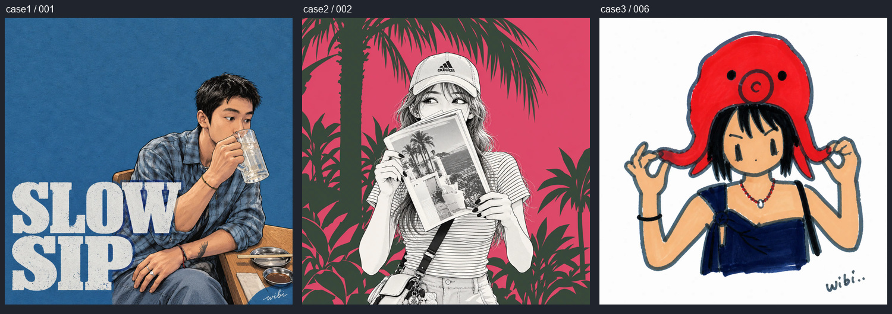

# 推广模板素材库

## 2026-10-27 新增三组（第二批）

用户重复使用 case1–3 目录名，本批采用新 ID，保留首批 25 张和已有发布版本。17 张案例截图和 3 张明确参考截图已裁剪为 68 张展示衍生图、3 张实际生成参考图，原件和三份提示词核验 SHA-256 后归档到 `_intake/2026-10-27-references/`。完整核对见 [_review/2026-10-27-references/visual-review.json](_review/2026-10-27-references/visual-review.json)。

| 原目录 | 新模板                                             | 案例数 | 封面                   |
| ------ | -------------------------------------------------- | ------ | ---------------------- |
| case1  | [把自己画进独立漫画](indie-ink-portrait/README.md) | 6      | 001 · 耳机里的片刻     |
| case2  | [把生活印成复古海报](retro-grain-poster/README.md) | 5      | 001 · 街角的蓝与粉     |
| case3  | [掉进冷蓝漫画频道](cool-blue-glitch/README.md)     | 6      | 001 · 长椅上的冷蓝午后 |

三组均有 `creative-template.json` 草稿包，列入 `catalog.json` 的 `draftTemplateIds`，并已在 2026-10-27 保存到本机数据库草稿。三组 activeVersion 均为空，展示与创作开关均关闭，可在后台直接查看和编辑；以后也可由“导入本地已整理资料包”重新导入草稿。未自动上架、未替换现有主推、未运行付费生成。公开展示许可、来源作者和模型质量仍待记录；项目版配方已设置图一风格参考、图二用户照片。详细规则见[执行规范第 13 节](../../docs/CASE-TEMPLATE-PLAYBOOK.zh-CN.md#13-新批次与可选-referpng-的执行规则)。

本批验证：20 张源截图（17 张案例、3 张参考）及 71 张有效导出已逐项核对；68 张案例衍生图和 3 张参考图的原件哈希、尺寸、无损裁剪像素验证通过。类型检查、Lint、244 项单元/集成测试、6 项模拟生成浏览器测试通过。浏览器覆盖参考图导入、私有预览、上传与移除、旧版本保留、模拟创作以及桌面/手机原图完整展示。未执行真实模型质量测试。

整理日期：2026-10-26。执行依据：[案例执行规范](../../docs/CASE-TEMPLATE-PLAYBOOK.zh-CN.md)。

本批完成 case1–3，共 25 张来源截图、100 张网页衍生图；三组各有原始提示词、项目整理版提示词、模板资料、封面选择和逐图报告。原始截图在各组 `originals/` 中有字节一致的副本，用户提供的完整输入目录已在逐文件核验后迁入 `_intake/case1–3/`，原件未删除或修改。

## 三组模板

| 原目录 | 主题与资料                                     | 数量 | 成品输出目录                                                 | 首选封面                                                                    |
| ------ | ---------------------------------------------- | ---- | ------------------------------------------------------------ | --------------------------------------------------------------------------- |
| case1  | [把日常印成封面](blue-paper-comic/README.md)   | 10   | [blue-paper-comic](../../public/cases/blue-paper-comic/)     | [001 · SLOW SIP](../../public/cases/blue-paper-comic/001-after.webp)        |
| case2  | [闯进漫画这一格](color-block-manga/README.md)  | 8    | [color-block-manga](../../public/cases/color-block-manga/)   | [002 · 棕榈与红色假日](../../public/cases/color-block-manga/002-after.webp) |
| case3  | [今天有点小脾气](bold-marker-doodle/README.md) | 7    | [bold-marker-doodle](../../public/cases/bold-marker-doodle/) | [006 · 章鱼帽出游记](../../public/cases/bold-marker-doodle/006-after.webp)  |



## 文件怎么用

每个案例有稳定编号，编号对应原始文件，例如 `001` 对应 `1.png`。

| 后缀            | 用途                       | 规格                                       |
| --------------- | -------------------------- | ------------------------------------------ |
| `-after.webp`   | 首页封面、案例详情完整成品 | 1206×1206，无损                            |
| `-before.webp`  | 网页对比中的小原照         | 按各自真实边界提取，高 402px，无损；不放大 |
| `-compare.webp` | 保留原照与成品组合的推广图 | 1206×1608，无损，去掉手机界面及外围留边    |
| `-thumb.webp`   | 案例墙、列表预览           | 640×640，质量 90                           |

原照宽度范围为 256–631px，只能作为截图提取图使用。所有成品保持原作品画幅，标题、纸张、留白和已有署名保留；未进行生成修复或重绘。

`template.json` 包含每张图的裁剪框、原件与导出文件的 SHA-256、真实尺寸、前后图配对、标题、中文与英文图片说明、检查状态、封面及备选选择。网站接入时需要做字段筛选，完整提示词与内部记录不应进入客户端。

## 检查与报告

- [case1 逐图报告](blue-paper-comic/processing-report.md)
- [case2 逐图报告](color-block-manga/processing-report.md)
- [case3 逐图报告](bold-marker-doodle/processing-report.md)
- [全量视觉检查记录](_review/visual-review.json)
- [case1 成品总览](_review/case1-artworks.jpg)
- [case2 成品总览](_review/case2-artworks.jpg)
- [case3 成品总览](_review/case3-artworks.jpg)

25 张源图和 100 张导出图已通过联系表逐图检查。程序验证所有非缩略图与原截图裁剪区域像素完全一致，缩略图解码、尺寸与压缩误差符合检查条件。素材导出检查不等于本站模型生成质量验证。

素材整理阶段首次运行应用测试时，默认测试库账号密码不匹配。页面接入阶段改用本地已有连接配置派生的独立 `_test` 数据库，在不修改 `.env`、数据库密码和测试规则的前提下，全部 23 个测试文件、175 项测试通过；类型检查和 lint 也通过。

## 主推建议与缺失项

优先验证 `blue-paper-comic`：蓝纸、大字和日常动作的组合有清楚的视觉识别，建议 `001` 做首屏候选，`007` 与 `009` 补充场景。当前依据为视觉整理，尚无模型稳定性与转化数据。

`color-block-manga` 与 `bold-marker-doodle` 原提示词都依赖额外的风格参考图，当前未提供，已在资料中标明。第三组整理版移除了要求复制个人签名的段落，原文与图片署名仍完整保留。

三组案例均标记为收集参考，原案例使用的模型、费用、生成表现、来源链接和作者身份仍未知。素材清单的 `status=ready` 表示整理完成；其中的 `generationReady=false` 是初始素材整理阶段的记录，现已由数据库中独立的创作开关取代，不能用它推断线上是否可创建。

原始截图和提示词已完整迁出 `public`，保存在非公开的 `_intake/case1–3/` 以及各模板目录。`public/cases/` 现在只保留三个系列的裁剪展示图片。模型实测和发布部署尚未执行。

## 页面接入状态

用户随后明确要求将这三组放到网站展示，已在各组资料中记录展示指令；来源身份仍为收集参考，未改写为本站生成结果。

- 首页：`/` 或 `/zh`，主推蓝纸海报，可切换三个系列，精选展示 9 张案例。
- 案例墙：`/styles` 或 `/zh/styles`，共 25 张，支持系列筛选、搜索、每批 24 张及加载更多。
- 系列详情：`/styles/<模板 ID>`，展示该系列全部案例。
- 单张详情：`/styles/<模板 ID>/<案例编号>`，支持原照对比和上下张；画廊内也支持弹层放大。
- 油画、水彩等旧预设暂时从公共目录和工作台选项下架，历史配方及已生成作品保留。
- 2026-10-27 已接入三组独立的单图文字生成配方，案例页可以进入对应工作台；完整配方留在服务端。第二、三组是明确的单图适配，并非已验证的原稿双图复现。均尚未进行真实模型效果实测。

页面验证：独立的公开页面浏览器检查 `pnpm exec playwright test --config playwright.public.config.ts` 共 10 项全部通过，覆盖桌面 1440px、手机 390px、封面切换、筛选搜索、25 张分页、原照弹层、键盘切换与关闭、焦点恢复、语言切换和详情链接。

2026-10-27 排版修复：案例墙改为按卡片实际高度填入最短列，字体和图片尺寸变化、窗口缩放、筛选、加载更多都会重新计算布局。保持图片完整比例及原始 DOM 顺序；浏览器增强前使用普通网格兜底。25 张作品在桌面三列按 9/8/8 分布，避免原生 CSS 多栏的 9/9/7 长空白。当前 183 项单元与集成测试全部通过。

网站展示、工作台和后台现在统一读取数据库的已发布创作模板。[catalog.json](catalog.json) 保留为本地资料包清单。每组新增 `generation-v1.json` 单图配方整理稿与 `creative-template.json` 完整导入包；首次数据已通过新迁移导入为 v1。

后续在 `/zh/admin/templates` 导入资料包，先保存到草稿，再按需要发布。后台支持主题与案例编辑、封面与顺序、模型和参数配置、管理员试跑、版本切换，以及独立展示/创作开关。相同 ID 重新导入不会覆盖线上版本；后台可导出草稿包。完整步骤以执行规范第 12 节为准。

## 复跑工具

[scripts/prepare-case-assets.py](../../scripts/prepare-case-assets.py) 使用已提供的 Pillow，不添加项目依赖。本批入库资料在 `_review/intake.json`，逐图原照边界在 `_review/photo-crops.json`，视觉结论在 `_review/visual-review.json`。

```text
python scripts/prepare-case-assets.py inspect
python scripts/prepare-case-assets.py initialize
python scripts/prepare-case-assets.py export
python scripts/prepare-case-assets.py verify
python scripts/prepare-case-assets.py report
```

工具当前明确处理 case1–3。新增批次按执行规范先检查，再更新入库资料和工具目标组；不得套用本批像素边界。`initialize` 保留已有资料，`export` 保留并核验原件，使用源哈希与裁剪参数识别未变化项。`report` 只在本批全部导出图已被实际检查、对应视觉记录已填写后运行。

在本机使用依赖工具返回的 Python 运行时；仓库依赖与前端代码不需为图片整理调整。
