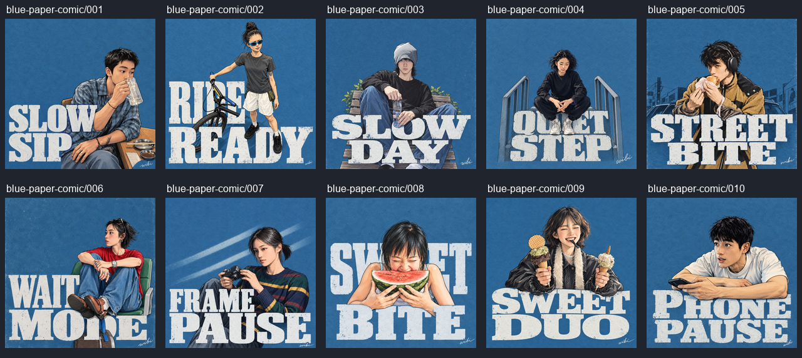

# 把日常印成封面

- 稳定 ID：`blue-paper-comic`
- 主题：旧蓝纸、漫画线条和大字标题，让日常瞬间成为一张封面。
- 视觉特征：旧蓝纸、蘸水笔轮廓、轻水彩、窄体大字、人物与文字穿插。
- 案例数量：10，来自用户提供的 `public/cases/case1`。
- 适合照片：参考作品覆盖单人坐姿、半身、全身、吃喝、摄影等日常动作；本站模型适用性待验证。
- 不适合照片：多人、宠物、极暗场景尚无已验证结论；手与物件不清楚的输入需要重点检查。
- 风格参考图：原文未要求额外参考图；`references/` 当前为空。
- 提示词：[原文](p.md)、[项目整理版 v1](prompt-v1.md)。
- 封面案例：`001`，喝水动作和 SLOW SIP 标题关系清楚，小图中也能辨识蓝纸与人物。
- 备选封面：`007`（相机与斜光）、`009`（双份甜品与笑脸）。
- 代表对比：`001`。
- 来源与归属：用户从抖音收集；可见 `wibi` 署名，作者身份及来源链接未知，不根据签名推断作者。
- 验证状态：仅参考，未运行本站模型实测。
- 推广定位：主推候选；尚未验证为爆品，也未接入网站。
- 数据：[template.json](template.json)，含逐张源图、哈希、坐标、尺寸、前后图及说明。
- 检查记录：[processing-report.md](processing-report.md)。

## 预览

## 待补充

原始高清照片、来源链接及作者信息、公开推广使用情况、实际模型与生成参数。部分参考作品上方留白小于提示词的约三分之一要求，需实测确定最终规则。
