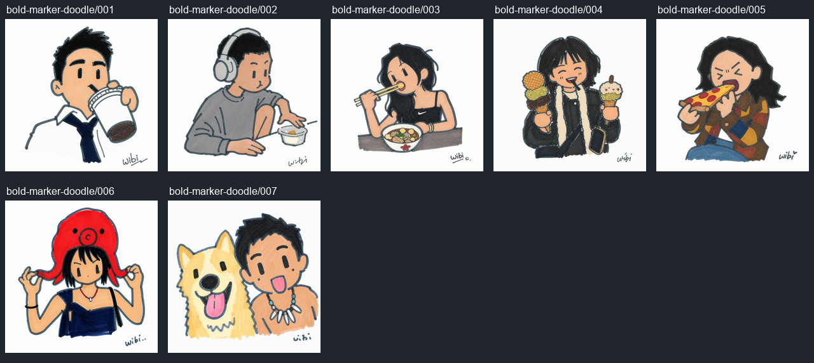

# 今天有点小脾气

- 稳定 ID：`bold-marker-doodle`
- 主题：用粗马克笔与夸张小表情，将人物和宠物画成随手涂鸦。
- 视觉特征：粗钝线、手涂色块、Q 版比例、白纸留白、少笔画表情。
- 案例数量：7，来自用户提供的 `public/cases/case3`。
- 适合照片：参考作品包括单人半身、吃喝、耳机、帽子和人与狗同框；本站模型适用性待验证。
- 不适合照片：复杂多人、纯宠物照片与严格四色下的多色服装待验证。
- 风格参考图：原文引用一张马克笔涂鸦参考，当前缺失；未将任何成品当作原参考。
- 提示词：[原文](p.md)、[项目整理版 v1](prompt-v1.md)。项目版不复制原文中的 `wibi` 个人署名要求。
- 封面案例：`006`，红色章鱼帽和双手拉帽动作识别度高，可与其他系列拉开区别。
- 备选封面：`007`（人与狗同框吐舌头）、`001`（白衬衫领带喝饮料）。
- 代表对比：`006`。
- 来源与归属：用户从抖音收集；可见 `wibi` 署名，作者身份及来源链接未知，不根据签名推断作者。
- 验证状态：仅参考，待补原风格参考图，未运行本站模型实测。
- 推广定位：编辑精选；不是基于流量或转化数据的热门排名。
- 数据：[template.json](template.json)，含逐张源图、哈希、坐标、尺寸、前后图及说明。
- 检查记录：[processing-report.md](processing-report.md)。

## 预览

## 待补充

原风格参考图、高清照片、来源资料、公开推广使用情况、模型和输入参数。部分样图超出严格四色，部分表情与原文“倔强”不一致，需实测决定下一版规则。
