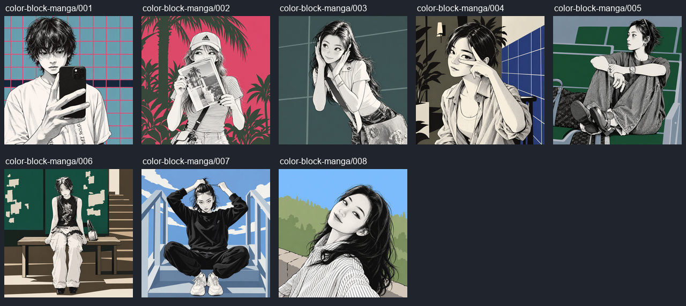

# 闯进漫画这一格

- 稳定 ID：`color-block-manga`
- 主题：细致黑白漫画人物与照片提炼的彩色背景相遇。
- 视觉特征：黑白人物、细钢笔线、网点、实黑、限色背景。
- 案例数量：8，来自用户提供的 `public/cases/case2`。
- 适合照片：参考作品覆盖自拍、旅行、坐姿、室内和手持物；本站模型适用性待验证。
- 不适合照片：多人、宠物、复杂遮挡待验证，不能依据这些单人参考推断全部适用。
- 风格参考图：原文要求一张主风格漫画参考，当前缺失；未将任何案例成品当作原参考。
- 提示词：[原文](p.md)、[项目整理版 v1](prompt-v1.md)。
- 封面案例：`002`，红色背景、深绿棕榈和黑白人物对比强，小图中颜色识别清楚。
- 备选封面：`001`（蓝底粉网格自拍）、`008`（蓝天绿山旅行照片）。
- 代表对比：`002`。
- 来源与归属：用户从抖音收集；作者和来源链接未知。
- 验证状态：仅参考，待补原风格参考图，未运行本站模型实测。
- 推广定位：编辑精选；不是基于流量或转化数据的热门排名。
- 数据：[template.json](template.json)，含逐张源图、哈希、坐标、尺寸、前后图及说明。
- 检查记录：[processing-report.md](processing-report.md)。

## 预览

## 待补充

主风格参考图、原始高清照片、来源资料、公开推广使用情况、模型与双图输入参数。部分参考作品背景有纹理或层次，与原文纯平色要求不完全一致；整理版保留原要求，等待实测。
